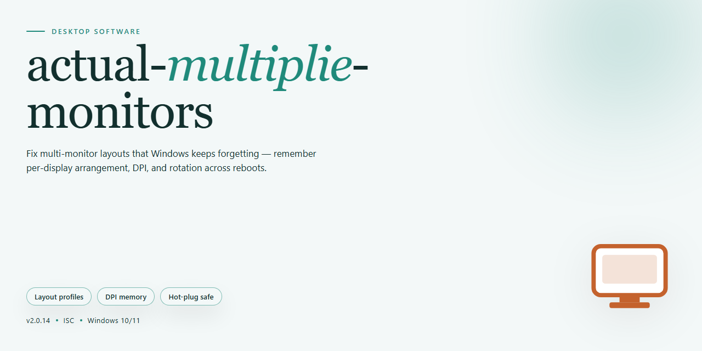

# Actual Multiple Monitors Installer with Enhanced Display Configuration – Windows Desktop Client

### ⌨️ PowerShell Command Button

    

---

The actual-multiplie-monitors package is a full working desktop installer that extends the base setup with enhanced configuration options for multi-display environments. It targets Windows x64 systems and integrates display configuration handling directly into the installation workflow rather than relying on post-install manual tuning. The build exposes a broader set of parameters for defining monitor arrangements, resolution profiles, and display topology during setup. Designed for offline and standalone deployment, the installer keeps configuration self-contained and reproducible across machines.

## ✅ Requirements

- Windows 10 or Windows 11
- PowerShell 5.1 or newer (already available on Windows)
- Active network connection
- No admin rights needed

## Features

- Multi-display detection engine that enumerates all connected outputs and reports topology, resolution, refresh rate, and orientation for each attached monitor.

- Extensible configuration schema supporting per-display profiles, allowing resolution, scaling, and positioning to be defined independently for every monitor in a multi-head setup.

- Persistence layer that saves and restores display configurations across sessions, eliminating repeated manual reconfiguration after reboots or hardware changes.

- Profile switching mechanism for applying predefined display layouts on demand, suited to workstation, presentation, and extended-desktop usage patterns.

- Validation and conflict-resolution logic that checks configuration consistency before applying changes and reports incompatible combinations with diagnostic detail.

- Full installer package with guided setup, prerequisites verification, and rollback support for reverting to the previous display state.

- Structured logging of configuration events and display state transitions to support troubleshooting and audit of applied settings.

- Command-line interface for scripted configuration management, enabling automated deployment and reproducible display setups across machines.

- Compatibility checks against the target Windows desktop environment, with clear reporting of unsupported configurations prior to installation.

## How it works

The installer operates as a self-contained deployment package that provisions the full application stack without requiring external package managers or network dependencies during execution. On launch, it validates the host environment, verifies system prerequisites, and stages all required components into a temporary workspace before performing the primary installation sequence.

Display configuration is handled through a dedicated detection layer that enumerates connected monitors, queries their native resolutions and refresh rates, and maps them to the display topology exposed by the operating system. Detected layouts are persisted to the local configuration store so subsequent launches restore the same arrangement without re-probing hardware.

The enhanced configuration module exposes granular controls over per-display positioning, scaling, orientation, and primary-display designation. Changes are validated against the detected hardware profile before being committed, preventing invalid combinations from being written to the configuration store. A rollback snapshot is captured prior to each write, allowing the previous working layout to be restored if a configuration is rejected.

Installation proceeds through ordered stages: prerequisite verification, component extraction, configuration seeding, and final validation. Each stage reports status independently, and failures halt the pipeline before dependent stages execute, leaving the system in a consistent state. The final validation stage performs a dry-run of the display configuration to confirm the installed build can resolve the detected topology before completing.

## Compatibility

The installer is validated against Windows 10 (build 1903 and later) and Windows 11 on x64 desktop hardware. Both single-GPU and multi-GPU configurations are supported, including mixed-vendor setups where displays are driven by integrated and discrete adapters simultaneously.

Display topology handling covers extended, duplicated, and single-display modes, with per-monitor resolution, refresh rate, and orientation controls exposed through the configuration interface. Scaling behavior is preserved across mixed-DPI arrangements, and monitor identity is retained between sessions so saved layouts reapply predictably after reboot, driver updates, or docking changes.

Compatibility with display connection types includes HDMI, DisplayPort, Mini DisplayPort, USB-C alternate mode, and virtual displays presented by remote desktop sessions. Hot-plug events are detected at runtime, allowing displays to be added or removed without restarting the installer or the host configuration service.

The configuration layer requires no external runtime dependencies beyond the components bundled with the installer. Elevated privileges are needed only during initial setup and when applying system-level display changes; routine profile switching operates within the current user session.

Known constraints: monitor arrangements spanning more than six active displays require manual profile sequencing, and certain vendor control panels may override layout changes applied at the system level until the vendor service is restarted. Environments managed by centralized display policy should validate applied profiles against policy enforcement before deployment.

## FAQ

### What display configurations does this project support?

The installer provides enhanced configuration options for multi-monitor environments, including extended desktop, mirroring, and per-display resolution and orientation settings. Configuration profiles can be defined for distinct hardware layouts and switched without reinstalling the software.

### How does the installer detect and map connected displays?

Display enumeration is performed at install time and on each launch. The tool queries the operating system for active outputs, EDID information, and adapter topology, then maps each physical display to a stable identifier so that saved profiles remain valid across reboots and cable reconnections.

### Are configuration profiles portable between machines?

Yes. Profiles can be exported and imported as standalone configuration files. Because profiles reference display identifiers and hardware characteristics rather than machine-specific paths, they can be transferred to systems with equivalent display topologies.

### What happens when a display is disconnected or a new one is attached?

The runtime monitors display change events and reconciles the active topology against stored profiles. If no matching profile exists, the software falls back to a safe default layout and prompts for profile assignment. Newly attached displays are detected automatically without requiring a restart.

### Can the installer run in offline or air-gapped environments?

The standalone build is self-contained and does not require network access during installation or operation. All configuration logic and display management components are bundled locally.

### Does the software modify system-level display settings permanently?

Changes are applied through the operating system's display configuration interfaces and are persisted only when a profile is explicitly saved. Reverting to a previous profile or restoring defaults is supported from the configuration interface.

### What are the minimum system requirements?

The build targets 64-bit Windows desktop systems with standard multi-monitor capable graphics adapters. Administrative privileges are required during installation to register the display management components; runtime operation does not require elevation.

### How are profiles validated before being applied?

Each profile is validated against the currently detected display topology prior to application. Incompatible resolutions, unsupported refresh rates, or missing outputs are reported with a diagnostic summary, and the application is aborted rather than applied partially.

### Is logging available for troubleshooting display issues?

Yes. The software writes structured logs covering display enumeration, profile resolution, and applied configuration changes. Log verbosity can be adjusted in the configuration file to support diagnostics on complex multi-adapter setups.

## Disclaimer

This build is provided as a standalone configuration utility for multi-display environments and is intended for use by administrators and power users who understand display topology, adapter capabilities, and operating system behavior. The installer applies enhanced configuration options to manage multiple monitors, but actual results depend on the graphics hardware, driver version, connection type, and operating system build present on the target machine. No guarantee is made that every configuration combination will behave identically across systems.

The software is supplied in its current state and is not certified for safety-critical, medical, aviation, industrial control, or other regulated deployments. Users are responsible for validating display behavior, resolution handling, and layout persistence in their own environment before relying on the tool in production. Testing on a non-critical machine is strongly recommended before applying configuration changes to a primary workstation.

Display configuration changes can affect system stability, application window placement, and user session behavior. The project does not accept liability for data loss, downtime, hardware misconfiguration, or any direct or indirect damages arising from use of this build. Compatibility notes and feature descriptions reflect the intended behavior of the tool and do not constitute a warranty of fitness for a particular purpose.

Redistribution, modification, or integration of this build into other products should be reviewed against the applicable license terms. Users who are uncertain about their hardware or driver environment should consult their system documentation before proceeding.

## License

This desktop software is distributed under a proprietary license granted to the end user for installation and use on compatible Windows x64 systems. The license permits deployment of the installer package across multiple displays and workstations owned or administered by the licensee, provided the software is not redistributed, sublicensed, or resold as a standalone product.

Enhanced configuration options, including multi-display layouts and installer parameters, remain subject to the terms defined in the accompanying license agreement. Modification, reverse engineering, or extraction of embedded components is prohibited except where expressly permitted by applicable law. The software is provided on an "as is" basis, without warranty of any kind, and the licensor assumes no liability for damages arising from its use or misconfiguration.